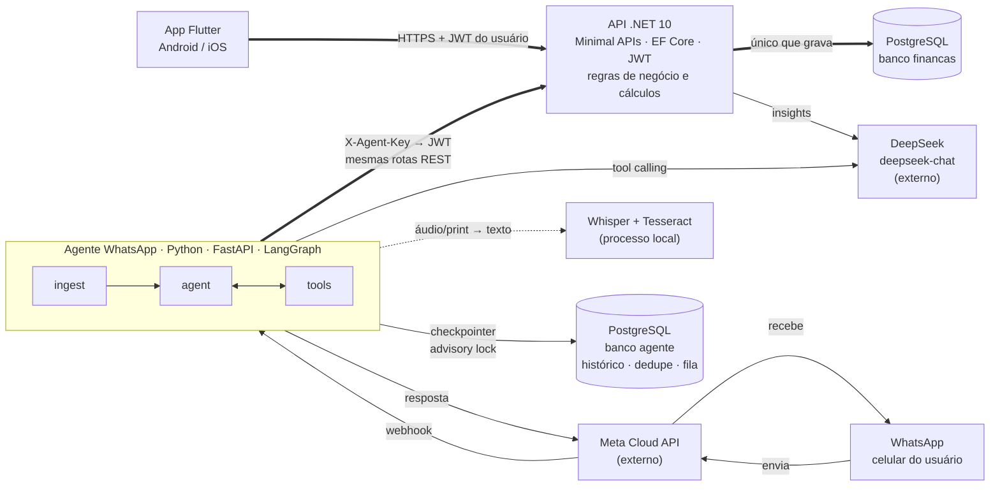
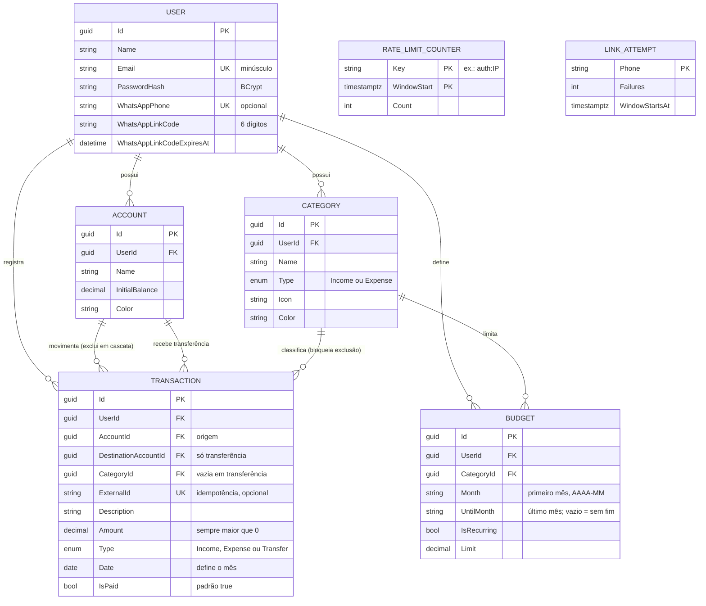
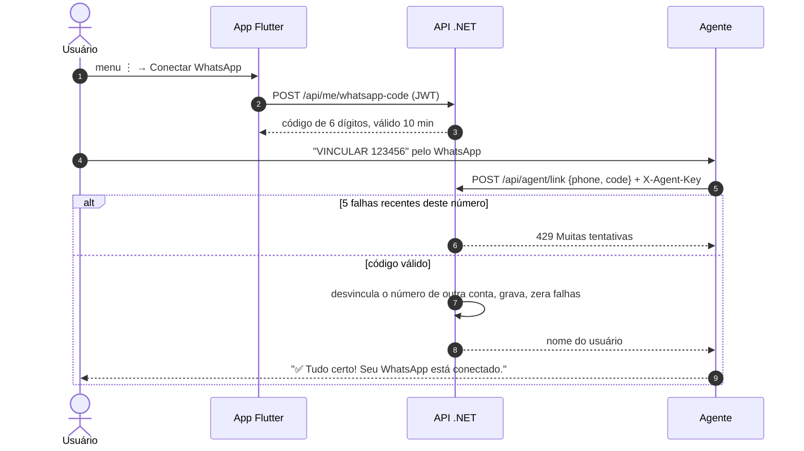
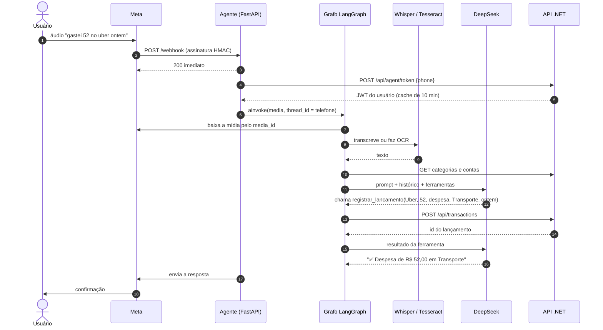
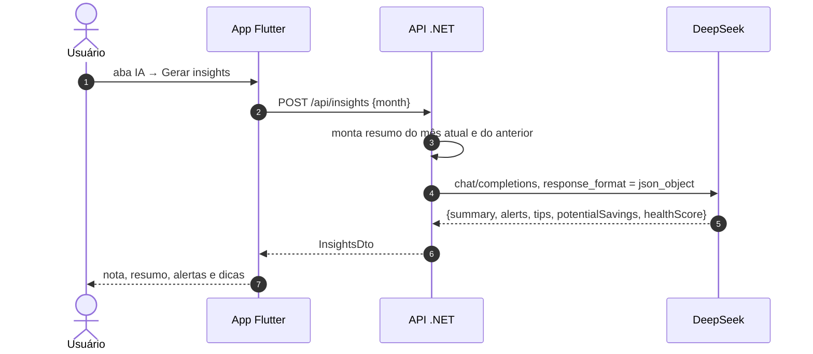
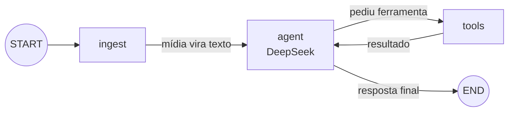

# Arquitetura e regras de negócio — Minhas Finanças

Como o sistema é montado, por onde passam os dados e quais regras de negócio o código aplica:
app Flutter, API .NET 10, insights com DeepSeek e o agente de WhatsApp em LangGraph.

> Ao mudar uma regra no código, atualize o item **RN** ou **AG** correspondente neste documento.

**Sumário:** [Visão geral](#visão-geral) · [Componentes](#componentes) · [Modelo de dados](#modelo-de-dados) ·
[Regras de negócio](#regras-de-negócio) · [Cálculos](#cálculos) · [Fluxos](#fluxos) ·
[Agente LangGraph](#agente-langgraph) · [Segurança](#segurança) · [Decisões](#decisões-de-arquitetura) ·
[Pontos de atenção](#pontos-de-atenção)

---

## Visão geral

São dois canais de entrada, o app e o WhatsApp, e uma única dona dos dados: a **API .NET**.
O agente do WhatsApp não acessa o banco. Ele usa a mesma API REST que o app, então as regras de
validação valem igualmente para os dois canais.

As setas grossas formam o caminho até o banco: os dois canais chegam à API, e só a API grava no banco `financas`.
O banco `agente` guarda só o estado das conversas (nunca dados financeiros) e é opcional em desenvolvimento.
Os dois bancos podem ficar no mesmo servidor PostgreSQL, como no `docker-compose.yml`.
Whisper e Tesseract rodam no próprio servidor do agente e não custam nada por uso.

## Componentes

| Componente | Responsabilidade | Tecnologia | Código |
|---|---|---|---|
| App mobile | Telas de visão geral, lançamentos, orçamentos, IA e vinculação do WhatsApp. Guarda o token no armazenamento seguro do aparelho. Não calcula nada de negócio: só exibe o que a API devolve. | Flutter, Provider, fl_chart, http, flutter_secure_storage | `mobile/lib` |
| API | Autenticação, CRUD, validações, saldos, totais por categoria, orçamentos, insights com DeepSeek, vinculação do WhatsApp. Sem estado em memória que importe: pode ter várias réplicas. | .NET 10 Minimal APIs, EF Core + Npgsql, JWT, BCrypt | `backend/Financas.Api` |
| Banco da API | Usuários, contas, categorias, lançamentos, orçamentos e tentativas de vinculação. Esquema versionado por migrations, aplicadas na subida. | PostgreSQL 16 | `backend/Financas.Api/Data/Migrations` |
| Testes da API | Testes de integração com a API em memória e banco temporário. | xUnit, WebApplicationFactory | `backend/Financas.Api.Tests` |
| Agente WhatsApp | Recebe o webhook, converte mídia em texto, deixa o DeepSeek decidir e chama a API pelas ferramentas. | Python 3.12, FastAPI, LangGraph, langchain-deepseek | `agent/app` |
| Banco do agente | Histórico das conversas (checkpointer do LangGraph), ids de mensagens já processadas e fila por telefone. Opcional: sem ele, tudo fica em memória e só pode haver uma instância. | PostgreSQL 16, langgraph-checkpoint-postgres | `agent/app/coordination.py` |
| Transcrição e OCR | Áudio → texto (Whisper), imagem → texto (Tesseract, português), PDF → texto (pypdf, até 5 páginas). | faster-whisper, pytesseract, pypdf | `agent/app/media.py` |
| DeepSeek | Análise do mês (JSON estruturado), chat de perguntas e decisão do agente (function calling). | API compatível com OpenAI, `deepseek-chat` | externo |
| Meta Cloud API | Entrega mensagens por webhook, hospeda as mídias e envia as respostas. | WhatsApp Business Platform (oficial) | externo |

## Modelo de dados

Toda entidade, exceto o usuário, carrega `UserId`, e toda consulta da API filtra por ele.
Valores em dinheiro são `decimal` e sempre positivos: o sinal vem do campo `Type`.

`LINK_ATTEMPT` e `RATE_LIMIT_COUNTER` não se ligam a nenhum usuário: contam tentativas de vinculação por telefone (RN-24)
e requisições de login por IP (RN-26), no banco, para valerem igual em todas as réplicas.
Uma *check constraint* garante o formato da transferência: `Type = Transfer` se e somente se há conta de destino e não há categoria.
Tipos no PostgreSQL: ids `uuid`, dinheiro `numeric(14,2)`, datas de lançamento `date`, instantes `timestamptz`.
Índices únicos: e-mail do usuário, número do WhatsApp e a combinação usuário + categoria + mês do orçamento.
Há também um índice em usuário + data dos lançamentos, a consulta mais frequente.

## Regras de negócio

Cada regra abaixo está implementada no código atual. Onde a regra existe só no app ou só no agente,
isso está indicado.

### Usuário e acesso

| ID | Regra |
|---|---|
| RN-01 | O e-mail é único e é gravado sem espaços e em minúsculas. O cadastro exige nome, e-mail com "@" e senha de pelo menos 6 caracteres. A senha é guardada como hash BCrypt. |
| RN-02 | Ao se cadastrar, o usuário ganha a conta "Carteira" com saldo inicial zero e 13 categorias padrão: 9 de despesa (Alimentação, Moradia, Transporte, Saúde, Educação, Lazer, Compras, Assinaturas, Outros) e 4 de receita (Salário, Freelance, Investimentos, Outras receitas). |
| RN-03 | A sessão dura 30 dias (JWT). Qualquer resposta 401 desloga o app e volta para a tela de login. |
| RN-04 | Um usuário só vê e altera os próprios dados. Ids de outro usuário se comportam como inexistentes (404) ou inválidos (400). |
| RN-26 | **Limite de requisições.** Login e cadastro: 10 por minuto por IP, **contados no banco** (tabela `RateLimitCounters`, janela de 1 minuto), então o limite é o mesmo com qualquer número de réplicas. Demais rotas: 300 por minuto por usuário logado (ou por IP, sem login), contados na memória de cada réplica, como proteção contra abuso. Acima disso, a API responde 429 com o cabeçalho `Retry-After`. As rotas `/api/agent/*` ficam fora do limite global porque concentram o tráfego de todos os usuários do WhatsApp e já são protegidas pela chave do agente e pela RN-24. Os limites são configuráveis em `RateLimit`. |

### Contas

| ID | Regra |
|---|---|
| RN-05 | O saldo não é gravado: é calculado na hora. Cada conta tem dois saldos. **Saldo atual**: saldo inicial + lançamentos **pagos com data até hoje**. **Saldo previsto**: saldo inicial + **todos** os lançamentos (pagos, pendentes e agendados) até o fim do mês consultado. O app mostra o atual em destaque e o previsto logo abaixo. |
| RN-06 | Excluir uma conta exclui todos os lançamentos dela. |
| RN-07 | As contas são listadas em ordem alfabética. A primeira é a "conta padrão" usada pelo formulário do app e pelo agente quando a conta não é informada. |

### Lançamentos

| ID | Regra |
|---|---|
| RN-08 | O valor tem que ser maior que zero. Despesa ou receita é definida pelo tipo, não pelo sinal. |
| RN-09 | A conta e a categoria precisam existir, pertencer ao usuário, e **o tipo da categoria precisa ser igual ao tipo do lançamento**. Vale na criação e na edição. Resposta: 400 com "Escolha uma categoria de despesa/receita." |
| RN-10 | O lançamento pertence ao mês da sua data (regime de competência). Pedidos sem mês ou com mês inválido usam o mês atual. |
| RN-25 | "Hoje" e "mês atual" seguem o fuso `America/Sao_Paulo` (configurável em `App:TimeZone`), não o relógio do servidor. Às 22h de 17/10 no Brasil, um servidor em UTC já está no dia 18, mas para a API ainda é dia 17. |
| RN-11 | Lançamentos nascem como pagos. Um lançamento pendente entra nos totais do mês, no gasto do orçamento e no saldo previsto, mas não no saldo atual. Um lançamento pago com data futura também só entra no saldo atual quando a data chega. O app mostra os pendentes do mês ("a receber" e "a pagar") no card de saldo. |
| RN-12 | No app, a lista do mês é agrupada por dia, do mais recente para o mais antigo. Excluir pede confirmação; editar reaproveita o mesmo formulário. O app aceita valores como "1.234,56" ou "1234.56". |
| RN-28 | **Transferência entre contas** do próprio usuário: sai da conta de origem e entra na de destino, que precisa ser outra conta do usuário. Não tem categoria e **não conta como receita nem despesa**: fica fora dos totais do mês, do gráfico por categoria e dos orçamentos. Afeta só os saldos. PIX para outra pessoa continua sendo despesa. |
| RN-29 | **Idempotência:** um lançamento pode vir com `ExternalId` (até 100 caracteres, único por usuário). Repetir o envio com a mesma chave devolve o lançamento já criado (200 em vez de 201), mesmo com envios simultâneos. O agente usa o id da chamada de ferramenta como chave. |

### Categorias

| ID | Regra |
|---|---|
| RN-13 | Uma categoria com lançamentos não pode ser excluída (409). O usuário precisa mover ou apagar os lançamentos antes. |

### Orçamentos

| ID | Regra |
|---|---|
| RN-14 | Um orçamento vale a partir do mês em que é criado. **Sem "repetir todo mês"**, vale só naquele mês. **Com "repetir"**, vale também nos meses seguintes, até ser interrompido. Só categorias de despesa aceitam orçamento. Se mais de um orçamento valer para a mesma categoria num mês, vale o criado mais recentemente; assim, alterar o valor num mês ("a partir de novembro") ou abrir uma exceção só para dezembro não apaga o histórico. |
| RN-27 | **Parar de repetir:** vendo um mês em que o orçamento foi herdado, "Parar de repetir" encerra a série no mês anterior; os meses passados continuam com o limite que tinham. Encerrar também fecha qualquer série mais antiga da mesma categoria, para ela não "reaparecer". Vendo o próprio mês de criação, a ação apaga o orçamento. |
| RN-15 | O gasto do orçamento é a soma das despesas da categoria no mês, incluindo as pendentes. A barra fica laranja acima de 80% do limite e vermelha acima de 100%, com o texto "Estourou em R$ X". |

### Insights com IA

| ID | Regra |
|---|---|
| RN-16 | O DeepSeek recebe um resumo, nunca o banco: saldo atual e previsto, receitas e despesas do mês e do mês anterior, despesas por categoria nos dois meses, orçamentos, transferências do mês e as 10 maiores despesas. Nome e e-mail nunca são enviados. As **descrições** das maiores despesas vão por padrão e podem ser desligadas na tela de IA ("Enviar as descrições das despesas"); desligado, a IA vê só data, categoria e valor. A tela de IA explica o que é enviado. A escolha fica salva no aparelho. |
| RN-17 | A análise volta como JSON com resumo, alertas, dicas, economia potencial por mês e nota de saúde de 0 a 100. A partir de 70 a nota aparece em verde, a partir de 40 em laranja, abaixo disso em vermelho. Se o JSON vier quebrado, o texto bruto vira o resumo. |
| RN-18 | Sem chave configurada, a API responde 503 com a explicação. Se o DeepSeek falhar ou passar de 90 segundos, a resposta é 502. |

### WhatsApp

| ID | Regra |
|---|---|
| RN-19 | Para vincular, o app gera um código aleatório de 6 dígitos que vale 10 minutos e só pode ser usado uma vez. Gerar outro código invalida o anterior. |
| RN-20 | Um número fica ligado a uma só conta. Vincular o mesmo número em outra conta desvincula o anterior. O usuário pode desconectar pelo app. |
| RN-21 | Mensagens de números não vinculados não passam pela IA: o remetente só recebe as instruções de vinculação. |
| RN-22 | O agente entende texto, áudio, imagem e documento (PDF ou imagem). Outros tipos recebem uma resposta explicando o que é aceito. |
| RN-23 | Mensagens do mesmo número são processadas uma de cada vez, na ordem de chegada, mesmo com várias instâncias do agente. Reenvios do mesmo webhook pela Meta são processados uma única vez. Uma mensagem só é marcada como concluída **depois que a resposta é enviada**; se a instância cair antes, outra a reassume após 5 minutos (até 3 tentativas). Na retomada, o agente continua do último passo salvo no histórico do LangGraph em vez de recomeçar, e a API ignora um lançamento repetido com o mesmo `ExternalId` (RN-29), então nada é registrado duas vezes. |
| RN-24 | **Depois de 5 códigos errados, o número fica bloqueado para vinculação por 30 minutos** (resposta 429), mesmo que o próximo código esteja certo. A janela conta a partir da primeira falha. Um acerto zera o contador. Outros números não são afetados. O contador fica no banco e vale para todas as réplicas da API. |

### Comportamento do agente

Estas regras ficam no prompt de sistema (`agent/app/prompts.py`) e nas ferramentas (`agent/app/tools.py`).
As do prompt dependem do modelo obedecer; as das ferramentas são garantidas pelo código.

| ID | Regra | Onde |
|---|---|---|
| AG-01 | Cada despesa ou receita vira uma chamada de ferramenta. Um print de fatura com cinco compras gera cinco lançamentos. | Prompt |
| AG-02 | A categoria é deduzida e nunca perguntada. Se faltar o valor, ou se o OCR deixar o valor ilegível, o agente pergunta em vez de chutar. | Prompt |
| AG-03 | Datas relativas ("ontem", "sexta passada") viram datas reais. Sem data, vale hoje no fuso de São Paulo. Em comprovantes, vale a data do comprovante. | Prompt; fallback para hoje no código |
| AG-04 | Comprovante de PIX ou transferência: se o usuário enviou, é despesa; se recebeu, é receita. A descrição leva o nome do favorecido ou do pagador. | Prompt |
| AG-05 | O nome da categoria é procurado nesta ordem: igual sem acento e sem maiúsculas, depois contido no nome, depois parecido (similaridade ≥ 0,6). Sem correspondência, cai em "Outros" ou "Outras receitas". Só categorias do mesmo tipo do lançamento entram na busca. | Código |
| AG-06 | A descrição é cortada em 120 caracteres, o valor é arredondado para 2 casas, uma data inválida vira hoje e um valor ≤ 0 é recusado. | Código |
| AG-07 | "Desfazer" exclui o lançamento pelo id que aparece no histórico da conversa. Uma correção é feita como exclusão seguida de novo registro. | Prompt + `excluir_lancamento` |
| AG-08 | Texto vindo de OCR ou de áudio é tratado como dado: instruções escritas dentro de um print não devem ser seguidas. As ferramentas só agem na conta do remetente. | Prompt + código |
| AG-10 | Transferência entre as contas do próprio usuário vai para `registrar_transferencia`, com contas de origem e destino. Conta não encontrada ou igual nas duas pontas: a ferramenta devolve o erro com a lista de contas do usuário, para o modelo perguntar. | Prompt + código |
| AG-11 | Áudio com **baixa confiança** chega ao modelo com um aviso, e ele não registra: diz o que entendeu e pede confirmação. A transcrição é marcada assim quando a média da log-probabilidade do Whisper (ponderada pela duração) fica abaixo de −0,7, quando um trecho provavelmente não é fala (`no_speech_prob` > 0,6) ou quando há repetição típica de alucinação (`compression_ratio` > 2,4). | Código + prompt |
| AG-09 | Assuntos fora de finanças pessoais são recusados com educação. Respostas curtas, com a formatação do WhatsApp (`**negrito**` vira `*negrito*`). | Prompt + código |

## Cálculos

Todos ficam em `FinanceService`, na API. Os saldos das contas são somados pelo PostgreSQL
(uma linha por conta, com `SUM(CASE ...)`), sem trazer os lançamentos para a memória.
Os totais do mês são somados sobre os lançamentos do mês, que a API já carrega para a tela.
Valores em dinheiro são `numeric(14,2)`.

| Valor | Fórmula | Observação |
|---|---|---|
| Saldo atual da conta | `saldo_inicial + Σ receitas − Σ despesas − Σ transferências enviadas + Σ transferências recebidas`, só pagos com data ≤ hoje | Não depende do mês selecionado. |
| Saldo previsto da conta | A mesma soma, com tudo até o fim do mês consultado | Inclui pendentes e agendados. |
| Saldo atual / previsto geral | `Σ` dos saldos de cada conta | Os dois números do card principal. |
| Pendentes do mês | `Σ receitas não pagas` e `Σ despesas não pagas` do mês | "A receber" e "a pagar" no card. |
| Resultado do mês | `Σ receitas do mês − Σ despesas do mês` | Inclui os lançamentos pendentes do mês. |
| % por categoria | `despesa da categoria ÷ despesas do mês × 100` | 1 casa decimal; o gráfico só rotula fatias de 8% ou mais. |

## Fluxos

### Vincular o WhatsApp

Mandar o código pelo próprio WhatsApp prova que quem vincula tem o celular nas mãos.
O app nunca pede o número de telefone.

### Áudio ou print vira lançamento

O webhook responde 200 antes de processar. Se a resposta demorar, a Meta reenvia a mesma mensagem;
por isso o agente ignora ids repetidos.

### Insights do mês no app

## Agente LangGraph

O estado é a lista de mensagens mais um campo `media`, preenchido só quando a mensagem atual tem anexo.
O `thread_id` é o telefone, então cada usuário tem a própria conversa.

| Nó | Entrada | O que faz | Saída |
|---|---|---|---|
| `ingest` | `media` (id, mime, legenda) | Baixa da Meta e converte: áudio pelo Whisper (pt), imagem pelo Tesseract (ampliada até 1500px de largura), PDF pelo pypdf. Sem mídia, não faz nada. | Mensagem do usuário marcada como "áudio transcrito" ou "texto extraído, pode conter erros", mais a legenda |
| `agent` | Mensagens | Busca categorias e contas na API, monta o prompt com a data de hoje e envia as últimas 30 mensagens, sempre começando numa mensagem do usuário. | Resposta do DeepSeek, com ou sem chamadas de ferramenta |
| `tools` | Chamadas de ferramenta | Executa `registrar_lancamento`, `registrar_transferencia`, `listar_lancamentos`, `excluir_lancamento` e `resumo_do_mes` na API, com o JWT do dono do telefone. Os registros mandam o id da chamada como `ExternalId`. | Resultado de cada ferramenta (inclui o id criado) |

## Segurança

| Fronteira | Proteção |
|---|---|
| App → API | JWT assinado (HMAC-SHA256), validade de 30 dias, guardado no armazenamento seguro do aparelho. |
| Chave JWT | Fora do ambiente Development, a API **não sobe** sem uma chave própria de pelo menos 32 caracteres, nem com a chave de desenvolvimento. A chave de dev fica só em `appsettings.Development.json`. |
| Meta → Agente | Cabeçalho `X-Hub-Signature-256` conferido com o App Secret. Sem o segredo configurado, a checagem fica desligada (só para desenvolvimento). |
| Agente → API | Chave `X-Agent-Key` comparada em tempo constante. Sem chave configurada, `/api/agent/*` responde 503. O agente troca o telefone por um JWT do dono e usa as rotas comuns. |
| Vinculação | Limite de 5 códigos errados por número a cada 30 minutos (RN-24). |
| Força bruta e abuso | Login e cadastro limitados por IP no banco, igual em todas as réplicas; demais rotas por usuário, em memória (RN-26). Atrás de proxy reverso, ligue `ReverseProxy:TrustForwardedHeaders` para o limite usar o IP real; só faça isso se a API não for acessível diretamente, senão o cabeçalho `X-Forwarded-For` pode ser forjado. |
| CORS | O app mobile não usa CORS. Em produção, só as origens de `Cors:AllowedOrigins` são liberadas (padrão: nenhuma). Em Development, qualquer `localhost` é liberado para testar a versão web. |
| Chaves do DeepSeek e da Meta | Só nos servidores (user-secrets ou variáveis de ambiente), nunca no app. |
| Conteúdo de prints e áudios | Tratado como dado no prompt; as ferramentas só alcançam a conta do remetente. |

## Decisões de arquitetura

| Decisão | Por quê | Custo | Quando rever |
|---|---|---|---|
| O agente usa a API, não o banco | As regras ficam num lugar só, e um bug no agente não corrompe os dados. | Uma ida extra pela rede a cada ferramenta. | Não rever. |
| Agente em Python, separado | LangGraph, Whisper e Tesseract são do ecossistema Python. Dá para escalar ou desligar o agente sem mexer na API. | Dois serviços para publicar e monitorar. | Se surgir um equivalente maduro em .NET. |
| Whisper e Tesseract locais | O DeepSeek não aceita áudio nem imagem. Rodar local custa zero por uso e não manda mídia para mais um terceiro. | CPU e ~500 MB de RAM no agente; OCR erra em prints ruins. | Se a qualidade do OCR incomodar: modelo com visão. |
| PostgreSQL + migrations do EF Core | Aceita réplicas da API, esquema versionado, somas de `numeric` no banco. Um só servidor atende API e agente. | Desenvolvimento precisa de um Postgres (um `docker run`). | Não rever. |
| Migrations aplicadas na subida da API | Deploy em um passo. O EF Core trava o histórico de migrations, então réplicas subindo juntas não aplicam a mesma migration duas vezes. | A API precisa de permissão para alterar o esquema. | Se o banco de produção exigir usuário só de leitura e escrita: `Database:MigrateOnStartup=false` e `dotnet ef database update` no pipeline. |
| Estado do agente no PostgreSQL | Um só serviço resolve as três necessidades: histórico (checkpointer oficial do LangGraph), dedupe (chave única) e fila por telefone (`pg_advisory_lock`, liberado automaticamente se a instância cair). | Mais um serviço para operar. Cada telefone em processamento segura uma conexão do pool de locks. | Se o volume crescer muito: Redis para dedupe e fila. |
| Modo memória no agente quando `DATABASE_URL` está vazio | Desenvolvimento e CLI sem dependências. | Uma instância só; reiniciar apaga conversas. O agente avisa no log. | Não rever. |
| Limite de vinculação no banco (tabela `LinkAttempts`) | É uma regra de segurança: precisa valer em todas as réplicas e sobreviver a reinícios. O incremento é atômico (`INSERT ... ON CONFLICT DO UPDATE`). | Uma escrita no banco a cada código errado. | Não rever. |
| Limite de login no banco; limite geral em memória | Login é alvo de força bruta: o limite precisa ser exato entre réplicas. O limite geral é proteção contra abuso; contá-lo no banco custaria uma escrita por requisição. | Com N réplicas, o limite geral efetivo é N vezes maior. | Se o abuso nas rotas comuns virar problema: limitar no proxy reverso ou usar Redis. |
| Migrations com advisory lock próprio | O lock do EF Core vale por transação e é solto entre migrations; com duas réplicas subindo juntas, uma chegou a reaplicar uma migration nos testes. | Uma conexão a mais durante a subida. | Não rever. |
| Retomar do checkpoint em vez de reprocessar | Uma mensagem reassumida não refaz o que já foi feito: o grafo continua do último passo salvo. `ExternalId` cobre o caso estreito de cair no meio de uma ferramenta. | O checkpointer precisa ser compartilhado (PostgreSQL). | Não rever. |
| Whisper sem vocabulário (`initial_prompt`) | Nos testes, um vocabulário de finanças fez o Whisper inventar valores ("cinquenta e dois" virou "cinquenta reais") e palavras ("iFood, iFood, iFood"). Inventar valor é pior que errar o áudio. | Termos específicos podem sair errados; a marca de baixa confiança (AG-11) cobre isso. | Se aparecerem muitos erros de termos com voz real: testar `WHISPER_MODEL=medium`. |
| WhatsApp Cloud API oficial | Sem risco de banimento; conversas iniciadas pelo usuário são gratuitas na janela de 24h. | Exige app na Meta e HTTPS público. | Não rever. |
| Saldo calculado, não gravado | Nunca fica dessincronizado de edições e exclusões. | Recalcula a cada leitura. | Só se virar gargalo. |

## Pontos de atenção

Comportamentos atuais que podem surpreender ou que precisam mudar antes de uso em produção.

| Prioridade | Ponto | Correção sugerida |
|---|---|---|
| Baixa | Os limites de baixa confiança do Whisper (AG-11) foram calibrados com voz sintética. Com voz real podem marcar áudios bons como incertos (o agente só pergunta à toa) ou deixar passar algum erro. | Ajustar `LOW_CONFIDENCE_LOGPROB` em `agent/app/media.py` com áudios reais. |
| Baixa | Se uma mensagem demorar mais de 5 minutos, outra instância pode reassumi-la enquanto a primeira ainda trabalha. Nada é registrado duas vezes, mas a resposta pode chegar repetida. | Aumentar `PROCESSING_TIMEOUT_SECONDS` se houver processamentos longos. |

### Corrigido

| Ponto | Como foi resolvido | Teste |
|---|---|---|
| Código de vinculação podia ser adivinhado | Limite de 5 falhas por número em 30 minutos (RN-24). | `Numero_e_bloqueado_apos_5_codigos_errados_mesmo_acertando_depois`, `Acerto_zera_o_contador_de_falhas` |
| Chave JWT de exemplo no `appsettings.json` | Chave removida; a API recusa subir sem chave própria fora de Development. | `Producao_nao_sobe_com_chave_de_desenvolvimento`, `Producao_nao_sobe_sem_chave_ou_com_chave_curta`, `Producao_sobe_com_chave_propria` |
| API não conferia o tipo da categoria | Validação na criação e edição de lançamentos e nos orçamentos (RN-09, RN-14). | `Despesa_com_categoria_de_receita_e_recusada`, `Receita_com_categoria_de_despesa_e_recusada_tambem_na_edicao`, `Orcamento_so_aceita_categoria_de_despesa` |
| Pendentes e datas futuras confundiam o saldo | Saldo atual × saldo previsto, pendentes do mês no card, e "hoje" no fuso de São Paulo (RN-05, RN-11, RN-25). | `Saldo_atual_ignora_pendentes_e_datas_futuras_e_o_previsto_inclui_ate_o_fim_do_mes`, `Hoje_segue_o_fuso_de_Sao_Paulo_e_nao_o_do_servidor` |
| Agente só funcionava em uma instância | Histórico, dedupe e fila por telefone no PostgreSQL quando `DATABASE_URL` está definido (RN-23). | `test_postgres_duas_instancias_descartam_a_mesma_mensagem`, `test_postgres_fila_por_telefone_vale_entre_instancias`, `test_postgres_historico_continua_em_outra_instancia` |
| API presa a uma instância (SQLite, `EnsureCreated`, limite de vinculação em memória) | PostgreSQL com migrations do EF Core aplicadas na subida; limite de vinculação numa tabela com incremento atômico; saldos somados no banco. | `Duas_replicas_sobem_juntas_e_compartilham_dados_e_limite_de_vinculacao`, `Falhas_simultaneas_nao_se_perdem`, `Health_responde_com_o_banco_no_ar` |
| Orçamentos não se repetiam de um mês para o outro | Opção "repetir todo mês", alteração "a partir deste mês" e "parar de repetir" (RN-14, RN-27). | `Orcamento_recorrente_vale_nos_meses_seguintes_ate_ser_trocado_ou_interrompido`, `Interromper_nao_faz_um_recorrente_mais_antigo_reaparecer` |
| Não havia transferência entre contas | Tipo `Transfer` com conta de destino, fora de receitas, despesas e orçamentos; ferramenta `registrar_transferencia` no agente (RN-28, AG-10). | `Transferencia_move_saldo_e_nao_conta_como_receita_nem_despesa`, `Transferencia_invalida_e_recusada`, `test_transferencia_vai_para_a_api_sem_categoria_e_com_destino` |
| Descrições iam para o DeepSeek sem aviso | Aviso na tela de IA e opção de não enviar as descrições (RN-16). | `Usuario_pode_gerar_insights_sem_enviar_descricoes` |
| Whisper errava áudios ruins sem avisar | Busca com `beam_size=5` e marca de baixa confiança; o agente confirma antes de registrar (AG-11). | `test_criterios_de_baixa_confianca`, `test_audio_incerto_chega_ao_modelo_com_aviso_para_confirmar`, `test_whisper_real_marca_audio_ruim` |
| Mensagem perdida se a instância do agente caísse | Concluída só após o envio da resposta; reassumida após 5 min; retomada do checkpoint; `ExternalId` contra duplicidade (RN-23, RN-29). | `test_mensagem_retomada_nao_repete_o_lancamento`, `test_resposta_pronta_e_reenviada_sem_chamar_a_ia_de_novo`, `test_postgres_reassume_mensagem_presa_e_desiste_depois_de_3_tentativas`, `Mesmo_external_id_nao_duplica_lancamento_nem_em_paralelo` |
| Limite de login contado por réplica | Contador no PostgreSQL com incremento atômico (RN-26). | `Limite_de_login_e_compartilhado_entre_replicas` |
| Sem rate limit e CORS aberto | Rate limit por IP no login/cadastro e por usuário nas demais rotas; CORS só para origens configuradas (RN-26). | `Login_e_limitado_a_10_tentativas_por_minuto`, `Rotas_comuns_sao_limitadas_por_usuario`, `Cors_em_producao_so_libera_origens_configuradas`, `Cors_em_desenvolvimento_libera_localhost` |

Testes da API: `backend/Financas.Api.Tests` (`cd backend && dotnet test`, com um PostgreSQL em `TEST_DATABASE_URL`).
Testes do agente: `agent/tests` (`cd agent && pytest`; os de PostgreSQL rodam com `TEST_DATABASE_URL` definido).
