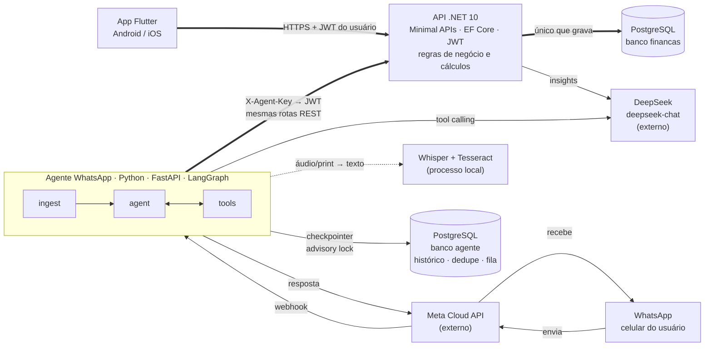
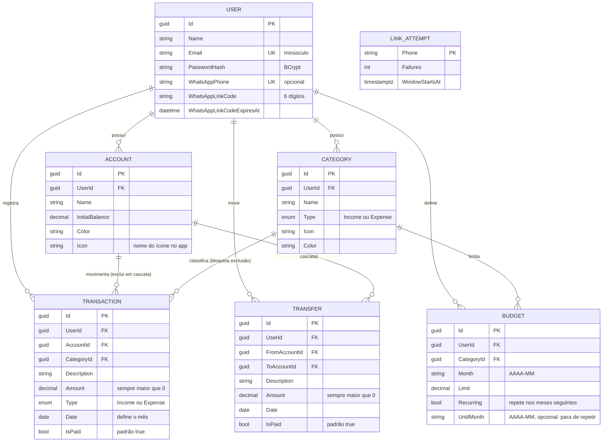
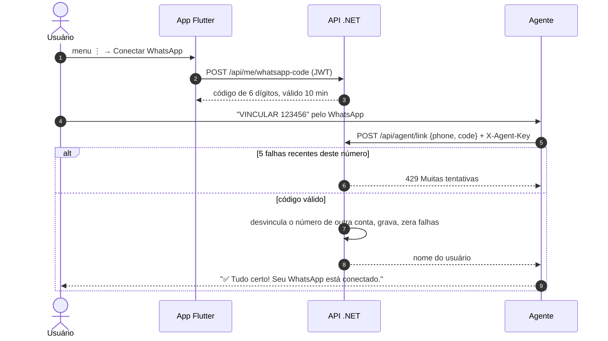
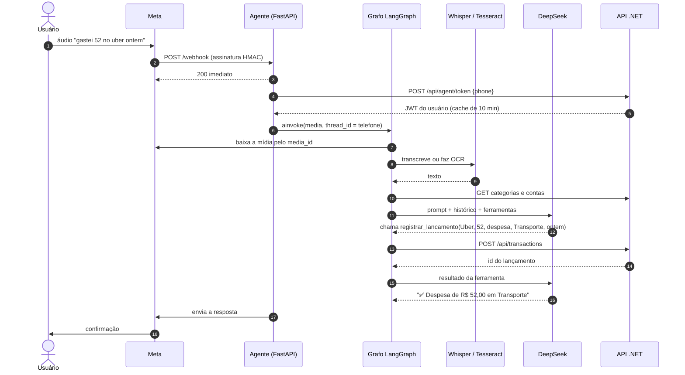
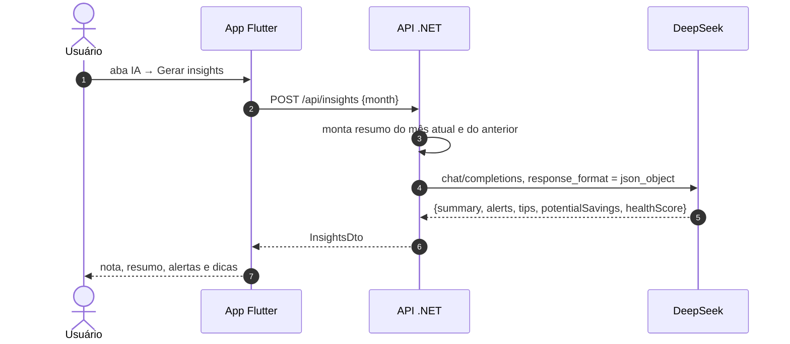
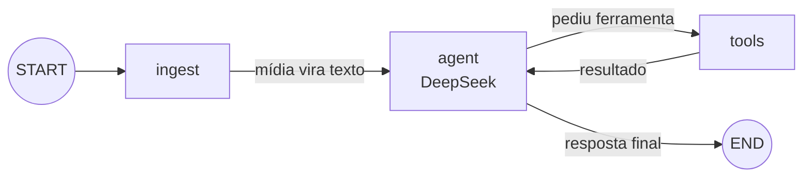

# Arquitetura e regras de negócio — Economizze

Como o sistema é montado, por onde passam os dados e quais regras de negócio o código aplica:
app Flutter, API .NET 10, insights com DeepSeek e o agente de WhatsApp em LangGraph.

> Ao mudar uma regra no código, atualize o item **RN** ou **AG** correspondente neste documento.

**Sumário:** [Visão geral](#visão-geral) · [Componentes](#componentes) · [Modelo de dados](#modelo-de-dados) ·
[Regras de negócio](#regras-de-negócio) · [Cálculos](#cálculos) · [Fluxos](#fluxos) ·
[Agente LangGraph](#agente-langgraph) · [Segurança](#segurança) · [Decisões](#decisões-de-arquitetura) ·
[Pontos de atenção](#pontos-de-atenção)

---

## Visão geral

São dois canais de entrada, o app e o WhatsApp, e uma única dona dos dados: a **API .NET**.
O agente do WhatsApp não acessa o banco. Ele usa a mesma API REST que o app, então as regras de
validação valem igualmente para os dois canais.

As setas grossas formam o caminho até o banco: os dois canais chegam à API, e só a API grava no banco `financas`.
O banco `agente` guarda só o estado das conversas (nunca dados financeiros) e é opcional em desenvolvimento.
Os dois bancos podem ficar no mesmo servidor PostgreSQL, como no `docker-compose.yml`.
Whisper e Tesseract rodam no próprio servidor do agente e não custam nada por uso.

## Componentes

| Componente | Responsabilidade | Tecnologia | Código |
|---|---|---|---|
| App mobile | Telas de visão geral, lançamentos, orçamentos, IA e vinculação do WhatsApp. Guarda o token no armazenamento seguro do aparelho. Não calcula nada de negócio: só exibe o que a API devolve. | Flutter, Provider, fl_chart, http, flutter_secure_storage | `mobile/lib` |
| API | Autenticação, CRUD, validações, saldos, totais por categoria, orçamentos, insights com DeepSeek, vinculação do WhatsApp. Sem estado em memória que importe: pode ter várias réplicas. | .NET 10 Minimal APIs, EF Core + Npgsql, JWT, BCrypt | `backend/Financas.Api` |
| Banco da API | Usuários, contas, categorias, lançamentos, orçamentos e tentativas de vinculação. Esquema versionado por migrations, aplicadas na subida. | PostgreSQL 16 | `backend/Financas.Api/Data/Migrations` |
| Testes da API | Testes de integração com a API em memória e banco temporário. | xUnit, WebApplicationFactory | `backend/Financas.Api.Tests` |
| Agente WhatsApp | Recebe o webhook, converte mídia em texto, deixa o DeepSeek decidir e chama a API pelas ferramentas. | Python 3.12, FastAPI, LangGraph, langchain-deepseek | `agent/app` |
| Banco do agente | Histórico das conversas (checkpointer do LangGraph), ids de mensagens já processadas e fila por telefone. Opcional: sem ele, tudo fica em memória e só pode haver uma instância. | PostgreSQL 16, langgraph-checkpoint-postgres | `agent/app/coordination.py` |
| Transcrição e OCR | Áudio → texto (Whisper), imagem → texto (Tesseract, português), PDF → texto (pypdf, até 5 páginas). | faster-whisper, pytesseract, pypdf | `agent/app/media.py` |
| DeepSeek | Análise do mês (JSON estruturado), chat de perguntas e decisão do agente (function calling). | API compatível com OpenAI, `deepseek-chat` | externo |
| Meta Cloud API | Entrega mensagens por webhook, hospeda as mídias e envia as respostas. | WhatsApp Business Platform (oficial) | externo |

## Modelo de dados

Toda entidade, exceto o usuário, carrega `UserId`, e toda consulta da API filtra por ele.
Valores em dinheiro são `decimal` e sempre positivos: o sinal vem do campo `Type`.

`LINK_ATTEMPT` não se liga a nenhum usuário: conta as tentativas erradas de vinculação por número de telefone (RN-24).
Tipos no PostgreSQL: ids `uuid`, dinheiro `numeric(14,2)`, datas de lançamento `date`, instantes `timestamptz`.
Índices únicos: e-mail do usuário, número do WhatsApp e a combinação usuário + categoria + mês do orçamento.
Há também um índice em usuário + data dos lançamentos, a consulta mais frequente.

## Regras de negócio

Cada regra abaixo está implementada no código atual. Onde a regra existe só no app ou só no agente,
isso está indicado.

### Usuário e acesso

| ID | Regra |
|---|---|
| RN-01 | O e-mail é único e é gravado sem espaços e em minúsculas. O cadastro exige nome, e-mail com "@" e senha de pelo menos 6 caracteres. A senha é guardada como hash BCrypt. |
| RN-02 | Ao se cadastrar, o usuário ganha a conta "Carteira" com saldo inicial zero e 13 categorias padrão: 9 de despesa (Alimentação, Moradia, Transporte, Saúde, Educação, Lazer, Compras, Assinaturas, Outros) e 4 de receita (Salário, Freelance, Investimentos, Outras receitas). |
| RN-03 | A sessão dura 30 dias (JWT). Qualquer resposta 401 desloga o app e volta para a tela de login. |
| RN-04 | Um usuário só vê e altera os próprios dados. Ids de outro usuário se comportam como inexistentes (404) ou inválidos (400). |
| RN-30 | **Exclusão da conta.** O usuário exclui a conta pelo app (menu → "Excluir minha conta"), confirmando a senha (`DELETE /api/me`). Numa transação, a API apaga lançamentos, transferências, orçamentos, contas, categorias, tentativas de vinculação do número e o usuário; depois pede ao agente (`POST /internal/forget`, rede interna, `X-Agent-Key`) para apagar o histórico de conversa e as mensagens guardadas do número. Desconectar o WhatsApp também apaga o histórico. Se o aviso ao agente falhar, a exclusão continua e o agente apaga o histórico na próxima mensagem do número, ao ver que ele não está mais vinculado; vincular um número também começa uma conversa nova. Cópias de segurança mantêm os dados por até 14 dias. Política pública: `mobile/web/privacidade.html` e `excluir-conta.html`. |
| RN-26 | **Limite de requisições.** Login e cadastro: 10 por minuto por IP. Demais rotas: 300 por minuto por usuário logado (ou por IP, sem login). Acima disso, a API responde 429 com o cabeçalho `Retry-After`. As rotas `/api/agent/*` ficam fora do limite global porque concentram o tráfego de todos os usuários do WhatsApp e já são protegidas pela chave do agente e pela RN-24. Os limites são configuráveis em `RateLimit`. |

### Contas

| ID | Regra |
|---|---|
| RN-05 | O saldo não é gravado: é calculado na hora. Cada conta tem dois saldos. **Saldo atual**: saldo inicial + lançamentos **pagos com data até hoje**. **Saldo previsto**: saldo inicial + **todos** os lançamentos (pagos, pendentes e agendados) até o fim do mês consultado. O app mostra o atual em destaque e o previsto logo abaixo. |
| RN-06 | Excluir uma conta exclui todos os lançamentos dela e as transferências de e para ela. |
| RN-07 | As contas são listadas em ordem alfabética. A primeira é a "conta padrão" usada pelo formulário do app e pelo agente quando a conta não é informada. |
| RN-28 | **Transferência entre contas.** Move dinheiro de uma conta do usuário para outra. Tira da origem e põe no destino, com as mesmas regras de pago e de data da RN-11 (pendente ou com data futura só entra no saldo previsto). **Não é receita nem despesa**: fica fora dos totais e do resultado do mês, das categorias, dos orçamentos e dos insights. O valor tem que ser maior que zero, as duas contas precisam ser do usuário e diferentes. No app, aparece na lista do dia com as duas contas, mas não soma no total do dia. O agente do WhatsApp não cria transferências. |

### Lançamentos

| ID | Regra |
|---|---|
| RN-08 | O valor tem que ser maior que zero. Despesa ou receita é definida pelo tipo, não pelo sinal. |
| RN-09 | A conta e a categoria precisam existir, pertencer ao usuário, e **o tipo da categoria precisa ser igual ao tipo do lançamento**. Vale na criação e na edição. Resposta: 400 com "Escolha uma categoria de despesa/receita." |
| RN-10 | O lançamento pertence ao mês da sua data (regime de competência). Pedidos sem mês ou com mês inválido usam o mês atual. |
| RN-25 | "Hoje" e "mês atual" seguem o fuso `America/Sao_Paulo` (configurável em `App:TimeZone`), não o relógio do servidor. Às 22h de 17/10 no Brasil, um servidor em UTC já está no dia 18, mas para a API ainda é dia 17. |
| RN-11 | Lançamentos nascem como pagos. Um lançamento pendente entra nos totais do mês, no gasto do orçamento e no saldo previsto, mas não no saldo atual. Um lançamento pago com data futura também só entra no saldo atual quando a data chega. O app mostra os pendentes do mês ("a receber" e "a pagar") no card de saldo. |
| RN-12 | No app, a lista do mês é agrupada por dia, do mais recente para o mais antigo. Excluir pede confirmação; editar reaproveita o mesmo formulário. O app aceita valores como "1.234,56" ou "1234.56". |

### Categorias

| ID | Regra |
|---|---|
| RN-13 | Uma categoria com lançamentos não pode ser excluída (409). O usuário precisa mover ou apagar os lançamentos antes. |

### Orçamentos

| ID | Regra |
|---|---|
| RN-14 | Existe no máximo um limite por categoria por mês; salvar de novo substitui o valor. **Só categorias de despesa aceitam orçamento**, e o limite tem que ser maior que zero. |
| RN-27 | **Orçamento que se repete.** Marcado como "repetir todo mês" (padrão no app), o orçamento vale também nos meses seguintes que não tiverem orçamento próprio para a categoria. Num mês, vale o orçamento do próprio mês; se não houver, o mais recente de um mês anterior que repete. Salvar num mês herdado cria um orçamento daquele mês: "repetir" faz o novo valor seguir dali em diante; "só este mês" muda só aquele mês, e o seguinte volta ao valor anterior. Excluir no mês de origem apaga o orçamento; excluir num mês herdado ("Parar de repetir") encerra a repetição a partir daquele mês, sem mexer nos anteriores. |
| RN-15 | O gasto do orçamento é a soma das despesas da categoria no mês, incluindo as pendentes. A barra fica laranja acima de 80% do limite e vermelha acima de 100%, com o texto "Estourou em R$ X". |

### Insights com IA

| ID | Regra |
|---|---|
| RN-16 | O DeepSeek recebe um resumo, nunca o banco: saldo total, receitas e despesas do mês e do mês anterior, despesas por categoria nos dois meses, orçamentos e as 10 maiores despesas (data, descrição, categoria, valor). Nome, e-mail e nomes das contas não são enviados; as descrições dos lançamentos são. A tela de IA avisa isso ao usuário. |
| RN-17 | A análise volta como JSON com resumo, alertas, dicas, economia potencial por mês e nota de saúde de 0 a 100. A partir de 70 a nota aparece em verde, a partir de 40 em laranja, abaixo disso em vermelho. Se o JSON vier quebrado, o texto bruto vira o resumo. |
| RN-18 | Sem chave configurada, a API responde 503 com a explicação. Se o DeepSeek falhar ou passar de 90 segundos, a resposta é 502. |

### WhatsApp

| ID | Regra |
|---|---|
| RN-19 | Para vincular, o app gera um código aleatório de 6 dígitos que vale 10 minutos e só pode ser usado uma vez. Gerar outro código invalida o anterior. |
| RN-20 | Um número fica ligado a uma só conta. Vincular o mesmo número em outra conta desvincula o anterior. O usuário pode desconectar pelo app. |
| RN-21 | Mensagens de números não vinculados não passam pela IA: o remetente só recebe as instruções de vinculação. |
| RN-22 | O agente entende texto, áudio, imagem e documento (PDF ou imagem). Outros tipos recebem uma resposta explicando o que é aceito. |
| RN-23 | Mensagens do mesmo número são processadas uma de cada vez, na ordem de chegada, mesmo com várias instâncias do agente. Reenvios do mesmo webhook pela Meta são processados uma única vez, em qualquer instância. |
| RN-29 | **Retomada.** Cada mensagem tem até 5 minutos para ser processada (`PROCESSING_TIMEOUT_SECONDS`) e só é marcada como concluída depois que a resposta é enviada. Uma mensagem sem conclusão há mais de 10 minutos (o dobro do prazo) é considerada abandonada por uma instância que caiu e é retomada por outra, até 3 tentativas no total (`RECOVERY_MAX_ATTEMPTS`). Na retomada, o prompt avisa o modelo para conferir no histórico se ela já foi registrada (AG-10). Só com PostgreSQL; no modo memória, o processo que cai leva tudo junto. |
| RN-24 | **Depois de 5 códigos errados, o número fica bloqueado para vinculação por 30 minutos** (resposta 429), mesmo que o próximo código esteja certo. A janela conta a partir da primeira falha. Um acerto zera o contador. Outros números não são afetados. O contador fica no banco e vale para todas as réplicas da API. |

### Comportamento do agente

Estas regras ficam no prompt de sistema (`agent/app/prompts.py`) e nas ferramentas (`agent/app/tools.py`).
As do prompt dependem do modelo obedecer; as das ferramentas são garantidas pelo código.

| ID | Regra | Onde |
|---|---|---|
| AG-01 | Cada despesa ou receita vira uma chamada de ferramenta. Um print de fatura com cinco compras gera cinco lançamentos. | Prompt |
| AG-02 | A categoria é deduzida e nunca perguntada. Se faltar o valor, ou se o OCR deixar o valor ilegível, o agente pergunta em vez de chutar. | Prompt |
| AG-03 | Datas relativas ("ontem", "sexta passada") viram datas reais. Sem data, vale hoje no fuso de São Paulo. Em comprovantes, vale a data do comprovante. | Prompt; fallback para hoje no código |
| AG-04 | Comprovante de PIX ou transferência: se o usuário enviou, é despesa; se recebeu, é receita. A descrição leva o nome do favorecido ou do pagador. | Prompt |
| AG-05 | O nome da categoria é procurado nesta ordem: igual sem acento e sem maiúsculas, depois contido no nome, depois parecido (similaridade ≥ 0,6). Sem correspondência, cai em "Outros" ou "Outras receitas". Só categorias do mesmo tipo do lançamento entram na busca. | Código |
| AG-06 | A descrição é cortada em 120 caracteres, o valor é arredondado para 2 casas, uma data inválida vira hoje e um valor ≤ 0 é recusado. | Código |
| AG-07 | "Desfazer" exclui o lançamento pelo id que aparece no histórico da conversa. Uma correção é feita como exclusão seguida de novo registro. | Prompt + `excluir_lancamento` |
| AG-08 | Texto vindo de OCR ou de áudio é tratado como dado: instruções escritas dentro de um print não devem ser seguidas. As ferramentas só agem na conta do remetente. | Prompt + código |
| AG-09 | Assuntos fora de finanças pessoais são recusados com educação. Respostas curtas, com a formatação do WhatsApp (`**negrito**` vira `*negrito*`). | Prompt + código |
| AG-10 | Numa mensagem retomada (RN-29), o agente confere no histórico se o lançamento já foi registrado antes de registrar de novo. A instância pode ter caído depois de gravar e antes de responder. | Prompt |

## Cálculos

Todos ficam em `FinanceService`, na API. Os saldos das contas são somados pelo PostgreSQL
(uma linha por conta, com `SUM(CASE ...)`), sem trazer os lançamentos para a memória.
Os totais do mês são somados sobre os lançamentos do mês, que a API já carrega para a tela.
Valores em dinheiro são `numeric(14,2)`.

| Valor | Fórmula | Observação |
|---|---|---|
| Saldo atual da conta | `saldo_inicial + Σ (receitas − despesas) + Σ (transferências recebidas − enviadas)`, tudo pago e com data ≤ hoje | Não depende do mês selecionado. |
| Saldo previsto da conta | Mesma soma, com tudo de data ≤ fim do mês consultado | Inclui pendentes e agendados. |
| Saldo atual / previsto geral | `Σ` dos saldos de cada conta | Os dois números do card principal. |
| Pendentes do mês | `Σ receitas não pagas` e `Σ despesas não pagas` do mês | "A receber" e "a pagar" no card. |
| Resultado do mês | `Σ receitas do mês − Σ despesas do mês` | Inclui os lançamentos pendentes do mês. |
| % por categoria | `despesa da categoria ÷ despesas do mês × 100` | 1 casa decimal; o gráfico só rotula fatias de 8% ou mais. |

## Fluxos

### Vincular o WhatsApp

Mandar o código pelo próprio WhatsApp prova que quem vincula tem o celular nas mãos.
O app nunca pede o número de telefone.

### Áudio ou print vira lançamento

O webhook responde 200 antes de processar. Se a resposta demorar, a Meta reenvia a mesma mensagem;
por isso o agente ignora ids repetidos. O id é gravado junto com o conteúdo da mensagem e só é marcado
como concluído depois da resposta, para outra instância retomar se esta cair no meio (RN-29).

### Insights do mês no app

## Agente LangGraph

O estado é a lista de mensagens mais um campo `media`, preenchido só quando a mensagem atual tem anexo.
O `thread_id` é o telefone, então cada usuário tem a própria conversa.

| Nó | Entrada | O que faz | Saída |
|---|---|---|---|
| `ingest` | `media` (id, mime, legenda) | Baixa da Meta e converte: áudio pelo Whisper (pt), imagem pelo Tesseract (ampliada até 1500px de largura), PDF pelo pypdf. Sem mídia, não faz nada. | Mensagem do usuário marcada como "áudio transcrito" ou "texto extraído, pode conter erros", mais a legenda |
| `agent` | Mensagens | Busca categorias e contas na API, monta o prompt com a data de hoje e envia as últimas 30 mensagens, sempre começando numa mensagem do usuário. | Resposta do DeepSeek, com ou sem chamadas de ferramenta |
| `tools` | Chamadas de ferramenta | Executa `registrar_lancamento`, `listar_lancamentos`, `excluir_lancamento` e `resumo_do_mes` na API, com o JWT do dono do telefone. | Resultado de cada ferramenta (inclui o id criado) |

## Segurança

| Fronteira | Proteção |
|---|---|
| App → API | JWT assinado (HMAC-SHA256), validade de 30 dias, guardado no armazenamento seguro do aparelho. |
| Chave JWT | Fora do ambiente Development, a API **não sobe** sem uma chave própria de pelo menos 32 caracteres, nem com a chave de desenvolvimento. A chave de dev fica só em `appsettings.Development.json`. |
| Meta → Agente | Cabeçalho `X-Hub-Signature-256` conferido com o App Secret. Sem o segredo configurado, a checagem fica desligada (só para desenvolvimento). |
| Agente → API | Chave `X-Agent-Key` comparada em tempo constante. Sem chave configurada, `/api/agent/*` responde 503. O agente troca o telefone por um JWT do dono e usa as rotas comuns. |
| Vinculação | Limite de 5 códigos errados por número a cada 30 minutos (RN-24). |
| Força bruta e abuso | Rate limit por IP no login e cadastro e por usuário nas demais rotas (RN-26). Atrás de proxy reverso, ligue `ReverseProxy:TrustForwardedHeaders` para o limite usar o IP real; só faça isso se a API não for acessível diretamente, senão o cabeçalho `X-Forwarded-For` pode ser forjado. |
| CORS | O app mobile não usa CORS. Em produção, só as origens de `Cors:AllowedOrigins` são liberadas (padrão: nenhuma). Em Development, qualquer `localhost` é liberado para testar a versão web. |
| Chaves do DeepSeek e da Meta | Só nos servidores (user-secrets ou variáveis de ambiente), nunca no app. |
| Conteúdo de prints e áudios | Tratado como dado no prompt; as ferramentas só alcançam a conta do remetente. |

## Decisões de arquitetura

| Decisão | Por quê | Custo | Quando rever |
|---|---|---|---|
| O agente usa a API, não o banco | As regras ficam num lugar só, e um bug no agente não corrompe os dados. | Uma ida extra pela rede a cada ferramenta. | Não rever. |
| Agente em Python, separado | LangGraph, Whisper e Tesseract são do ecossistema Python. Dá para escalar ou desligar o agente sem mexer na API. | Dois serviços para publicar e monitorar. | Se surgir um equivalente maduro em .NET. |
| Whisper e Tesseract locais | O DeepSeek não aceita áudio nem imagem. Rodar local custa zero por uso e não manda mídia para mais um terceiro. | CPU e ~500 MB de RAM no agente; OCR erra em prints ruins. | Se a qualidade do OCR incomodar: modelo com visão. |
| PostgreSQL + migrations do EF Core | Aceita réplicas da API, esquema versionado, somas de `numeric` no banco. Um só servidor atende API e agente. | Desenvolvimento precisa de um Postgres (um `docker run`). | Não rever. |
| Migrations aplicadas na subida da API | Deploy em um passo. Um advisory lock do PostgreSQL (`DatabaseMigrator`) faz as réplicas aplicarem uma de cada vez; o lock do próprio EF Core não basta quando há mais de uma migration pendente. | A API precisa de permissão para alterar o esquema. | Se o banco de produção exigir usuário só de leitura e escrita: `Database:MigrateOnStartup=false` e `dotnet ef database update` no pipeline. |
| Estado do agente no PostgreSQL | Um só serviço resolve as três necessidades: histórico (checkpointer oficial do LangGraph), dedupe (chave única) e fila por telefone (`pg_advisory_lock`, liberado automaticamente se a instância cair). | Mais um serviço para operar. Cada telefone em processamento segura uma conexão do pool de locks. | Se o volume crescer muito: Redis para dedupe e fila. |
| Modo memória no agente quando `DATABASE_URL` está vazio | Desenvolvimento e CLI sem dependências. | Uma instância só; reiniciar apaga conversas. O agente avisa no log. | Não rever. |
| Limite de vinculação no banco (tabela `LinkAttempts`) | É uma regra de segurança: precisa valer em todas as réplicas e sobreviver a reinícios. O incremento é atômico (`INSERT ... ON CONFLICT DO UPDATE`). | Uma escrita no banco a cada código errado. | Não rever. |
| Rate limit (RN-26) em memória, por réplica | É uma proteção contra abuso, não uma regra de negócio. Sem infraestrutura extra. | Com N réplicas, o limite efetivo é N vezes maior; zera ao reiniciar. | Se houver muitas réplicas: limitar no proxy reverso ou guardar contadores em Redis. |
| WhatsApp Cloud API oficial | Sem risco de banimento; conversas iniciadas pelo usuário são gratuitas na janela de 24h. | Exige app na Meta e HTTPS público. | Não rever. |
| Saldo calculado, não gravado | Nunca fica dessincronizado de edições e exclusões. | Recalcula a cada leitura. | Só se virar gargalo. |
| Transferência como entidade própria, não como par de lançamentos | Não precisa de categoria falsa nem de filtros em todos os totais, gráficos, orçamentos e insights para não contá-la como receita ou despesa. | Os saldos somam mais uma tabela; o app busca lançamentos e transferências separadamente. | Não rever. |
| Orçamento recorrente por herança, não por cópia | Um registro só vale para todos os meses seguintes; mudar o valor num mês não exige um job nem altera meses passados. | A consulta do mês precisa resolver qual orçamento vale (o mais recente que repete). | Não rever. |

## Pontos de atenção

Comportamentos atuais que podem surpreender ou que precisam mudar antes de uso em produção.

| Prioridade | Ponto | Correção sugerida |
|---|---|---|
| Baixa | O Whisper `small` erra em áudios com muito ruído. | `WHISPER_MODEL=medium`, mais lento. |
| Baixa | O rate limit da API (RN-26) é contado por réplica: com 3 réplicas, um IP consegue até 30 logins por minuto. | Limitar no proxy reverso ou usar Redis. |
| Baixa | A retomada do agente (RN-29) entrega "pelo menos uma vez": se a instância cair depois de gravar o lançamento e antes de responder, a retomada depende do modelo obedecer à AG-10 para não registrar de novo. | Gravar o id da mensagem no lançamento e recusar duplicados na API. |

### Corrigido

| Ponto | Como foi resolvido | Teste |
|---|---|---|
| Código de vinculação podia ser adivinhado | Limite de 5 falhas por número em 30 minutos (RN-24). | `Numero_e_bloqueado_apos_5_codigos_errados_mesmo_acertando_depois`, `Acerto_zera_o_contador_de_falhas` |
| Chave JWT de exemplo no `appsettings.json` | Chave removida; a API recusa subir sem chave própria fora de Development. | `Producao_nao_sobe_com_chave_de_desenvolvimento`, `Producao_nao_sobe_sem_chave_ou_com_chave_curta`, `Producao_sobe_com_chave_propria` |
| API não conferia o tipo da categoria | Validação na criação e edição de lançamentos e nos orçamentos (RN-09, RN-14). | `Despesa_com_categoria_de_receita_e_recusada`, `Receita_com_categoria_de_despesa_e_recusada_tambem_na_edicao`, `Orcamento_so_aceita_categoria_de_despesa` |
| Pendentes e datas futuras confundiam o saldo | Saldo atual × saldo previsto, pendentes do mês no card, e "hoje" no fuso de São Paulo (RN-05, RN-11, RN-25). | `Saldo_atual_ignora_pendentes_e_datas_futuras_e_o_previsto_inclui_ate_o_fim_do_mes`, `Hoje_segue_o_fuso_de_Sao_Paulo_e_nao_o_do_servidor` |
| Agente só funcionava em uma instância | Histórico, dedupe e fila por telefone no PostgreSQL quando `DATABASE_URL` está definido (RN-23). | `test_postgres_duas_instancias_descartam_a_mesma_mensagem`, `test_postgres_fila_por_telefone_vale_entre_instancias`, `test_postgres_historico_continua_em_outra_instancia` |
| API presa a uma instância (SQLite, `EnsureCreated`, limite de vinculação em memória) | PostgreSQL com migrations do EF Core aplicadas na subida; limite de vinculação numa tabela com incremento atômico; saldos somados no banco. | `Duas_replicas_sobem_juntas_e_compartilham_dados_e_limite_de_vinculacao`, `Falhas_simultaneas_nao_se_perdem`, `Health_responde_com_o_banco_no_ar` |
| Sem rate limit e CORS aberto | Rate limit por IP no login/cadastro e por usuário nas demais rotas; CORS só para origens configuradas (RN-26). | `Login_e_limitado_a_10_tentativas_por_minuto`, `Rotas_comuns_sao_limitadas_por_usuario`, `Cors_em_producao_so_libera_origens_configuradas`, `Cors_em_desenvolvimento_libera_localhost` |
| Réplicas subindo juntas com 2+ migrations pendentes falhavam ("column already exists") | Advisory lock do PostgreSQL em volta do `Migrate` (`DatabaseMigrator`). | `Duas_replicas_sobem_juntas_e_compartilham_dados_e_limite_de_vinculacao` |
| Orçamentos não se repetiam de um mês para o outro | Opção "repetir todo mês", com herança e "parar de repetir" (RN-27). | `Orcamento_recorrente_vale_nos_meses_seguintes_ate_ser_substituido_ou_parado`, `Excluir_no_mes_de_origem_apaga_o_orcamento_recorrente` |
| Não havia transferência entre contas | Entidade `Transfer`, que entra nos saldos e fica fora de receitas e despesas (RN-28). | `Transferencia_move_saldo_sem_contar_como_receita_ou_despesa`, `Transferencia_recusa_mesma_conta_e_conta_de_outro_usuario` |
| Não havia como excluir a conta (exigido pela LGPD e pela Google Play) | Exclusão com senha no app e na API, que também apaga o histórico do WhatsApp no agente (RN-30). | `Excluir_conta_apaga_todos_os_dados_e_avisa_o_agente_mas_nao_toca_em_outros_usuarios`, `Excluir_conta_exige_a_senha`, `Desconectar_o_whatsapp_pede_ao_agente_para_apagar_o_historico`, `test_conta_excluida_ou_desvinculada_apaga_o_historico`, `test_forget_exige_a_chave_do_agente`, `test_postgres_forget_apaga_as_mensagens_guardadas_do_numero` |
| Descrições iam para o DeepSeek sem o usuário saber | Aviso na tela de IA dizendo o que é enviado e o que não é (RN-16). | — (texto no app) |
| Mensagem perdida se a instância do agente caísse no meio | Conclusão marcada só depois da resposta; mensagens abandonadas são retomadas por outra instância (RN-29, AG-10). | `test_postgres_mensagem_abandonada_e_retomada_por_outra_instancia`, `test_postgres_desiste_depois_do_limite_de_tentativas`, `test_mensagem_retomada_avisa_o_modelo_para_nao_registrar_de_novo` |

Testes da API: `backend/Financas.Api.Tests` (`cd backend && dotnet test`, com um PostgreSQL em `TEST_DATABASE_URL`).
Testes do agente: `agent/tests` (`cd agent && pytest`; os de PostgreSQL rodam com `TEST_DATABASE_URL` definido).
